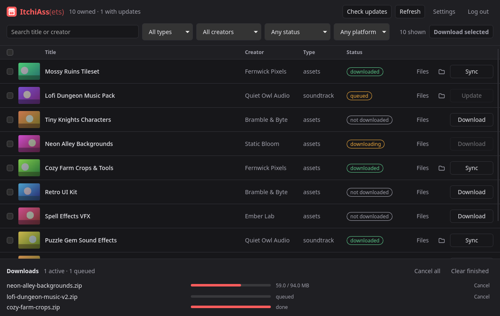

<h1 align="center">ItchiAss(ets)</h1>

Download everything you own on itch.io in one go, and keep it up to date.

## Download

Pick the file for your computer:

| Your computer | Download |
| --- | --- |
| Windows | [ItchiAssets.exe](https://github.com/bearlikelion/ItchiAssets/releases/latest/download/ItchiAssets.exe) |
| Mac with an M1 chip or newer | [ItchiAssets_AppleSilicon.dmg](https://github.com/bearlikelion/ItchiAssets/releases/latest/download/ItchiAssets_AppleSilicon.dmg) |
| Older Intel Mac | [ItchiAssets_Intel.dmg](https://github.com/bearlikelion/ItchiAssets/releases/latest/download/ItchiAssets_Intel.dmg) |
| Linux | [ItchiAssets.AppImage](https://github.com/bearlikelion/ItchiAssets/releases/latest/download/ItchiAssets.AppImage) |

## How to use it

1. Open ItchiAss(ets) and click **Log in with itch.io**.
2. Say yes in the browser window that pops up, then come back to the app.
3. Tick the things you want and click **Download selected**.

That's it.
Zip files unpack themselves, and **Check updates** tells you when a creator posts a newer version.

## Good to know

- Everything goes into your Downloads folder under **ItchiAss**, with one folder per creator. You can change this in **Settings**.
- Click **Files** on anything to choose which files you want, for example skipping the Unity version when you only use Godot.
- The folder button opens where something was saved.
- The app updates itself when a new version comes out.
- Items from itch.io bundles only show up after you claim them on the itch.io website.

## Seeing a warning the first time?

The app isn't signed by Microsoft or Apple yet, so your computer will be cautious the first time you open it.

- **Windows:** on "Windows protected your PC", click **More info**, then **Run anyway**.
- **Mac:** open **System Settings**, go to **Privacy & Security**, scroll down and click **Open Anyway**.
- **Linux:** right click the file, open **Properties**, and turn on **Allow executing file as program**.

## For developers

See [DEVELOPING.md](DEVELOPING.md).
